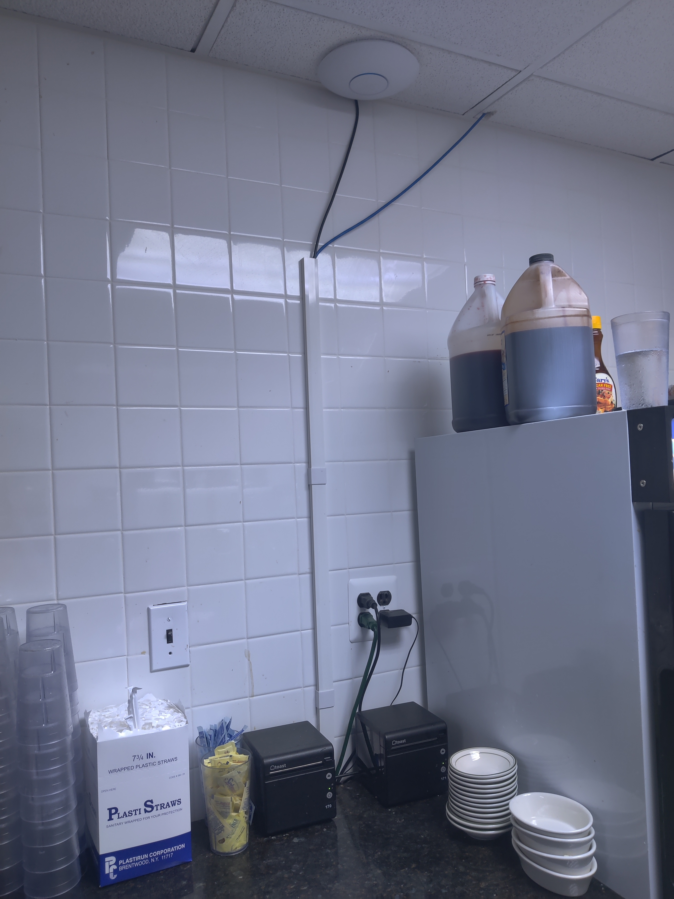
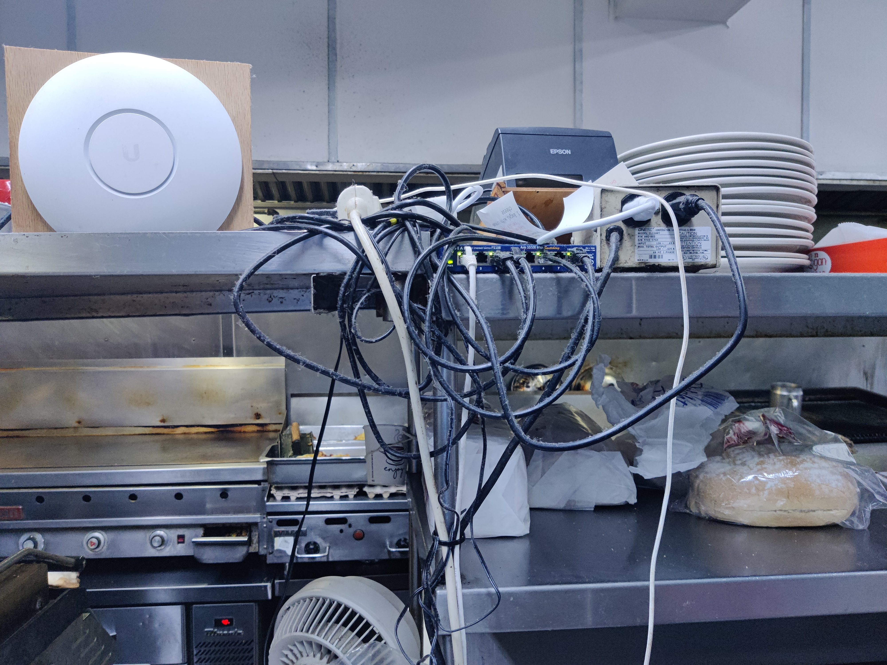
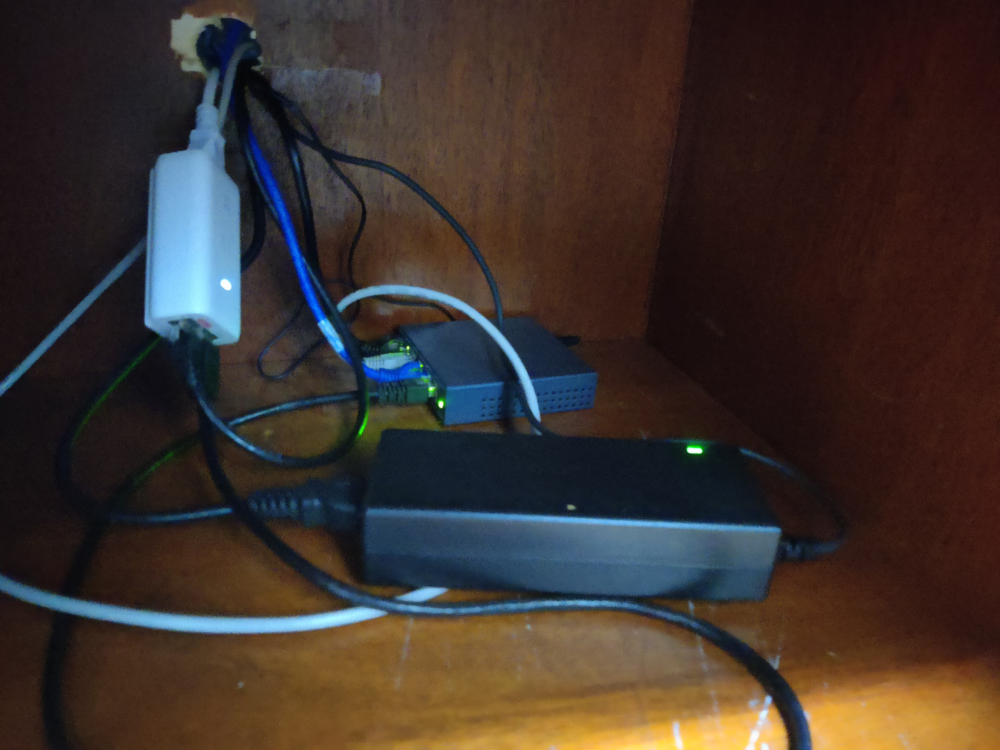
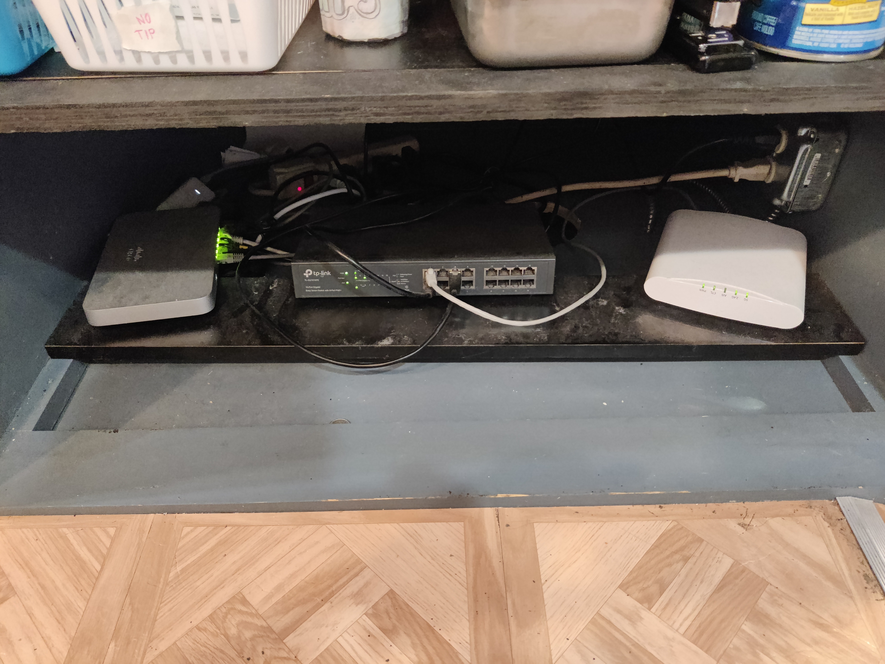
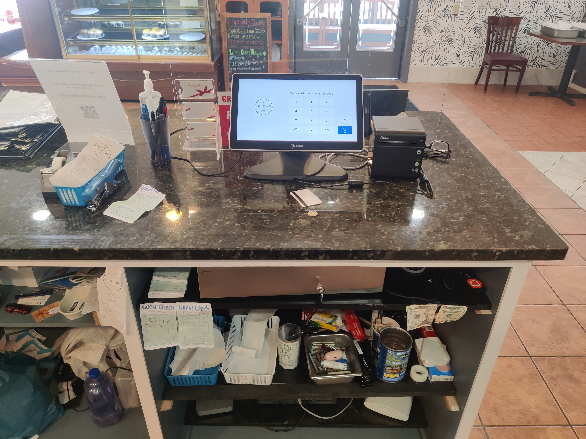

# 🌐 Small-Business Network Installation & Deployment
### 📍 Mosaic Café | Old Bridge, NJ

**Successfully deployed a robust, high-performance network infrastructure for Mosaic Café to support mission-critical restaurant operations, seamless POS transactions, and reliable customer Wi-Fi.**

---

## 📝 Project Overview

This hands-on infrastructure project involved planning, routing, configuring, and deploying a hybrid wired and wireless network. The installation guarantees zero-downtime connectivity for point-of-sale (POS) systems, kitchen printers, staff backend devices, and guest internet access. 

* **Completed:** 2021
* **Role:** Lead Network Deployment & Ongoing Technical Support

---

## 🛠️ Hardware & Tech Stack

| Category | Component / Tools Used |
| :--- | :--- |
| **Wireless Infrastructure** | 3x Ubiquiti UniFi Access Points |
| **Routing & Switching** | Enterprise Network Switches, Primary Gateway Router, Power Adapters |
| **Cabling & Management** | Solid-core Ethernet cabling, Surface-mount raceways |
| **Physical Tools** | Cable crimpers, Punch-down tools, Wall/Screw mounts, Testing equipment |
| **Connected Endpoints** | Front-of-house POS tablets, Kitchen ticket printers, Staff devices |

---

## 📐 Scope of Work

### 📶 Wireless Infrastructure
* Deployed **three ceiling-mounted Ubiquiti UniFi access points** strategically mapped across the kitchen, back room, and dining area to eliminate dead zones.
* Configured dedicated, isolated SSIDs for secure restaurant business operations and public customer access.

### 🔌 Structured Cabling & Hardware Setup
* Architected and routed Ethernet core infrastructure through basement pathways to eliminate visible wire clutter.
* Utilized professional **surface-mount raceways** for clean, protected vertical drops and aesthetic cable management.
* Rack-mounted and configured central network switches, routers, and power distribution units.

### 💼 POS & Systems Integration
* Integrated front-of-house (FOH) POS tablets and back-of-house (BOH) kitchen printers into the high-priority network lane.
* Completed rigorous signal testing and packet-loss validation to ensure uninterrupted transactional traffic.

### 🛠️ Maintenance & Support
* Conducted post-installation signal-mapping and coverage performance validation.
* Provided proactive ongoing on-site troubleshooting for hardware lifecycle updates and device connectivity.

---

## 📷 Project Gallery

### 🍳 Kitchen Area – AP Deployments
*Mounted UniFi APs on the ceiling with clean vertical cable routing to handle back-of-house ticketing traffic.*

| Primary Kitchen AP | Secondary Kitchen AP |
| :---: | :---: |
|  |  |

***

### 📦 Back Room & Dining Core
*Structured service cabinet placement alongside dining room wireless coverage extensions.*

| Infrastructure & Switch Cabinet | Dining Room Ceiling AP |
| :---: | :---: |
|  |  |

***

### 💳 Front Counter – Operations Core
*The primary network brain routed securely to the front-of-house point of sale tablet.*

| Primary Router & Switch Setup | Main POS Tablet Interface |
| :---: | :---: |
|  |  |

---

## 🧰 Tools & Equipment Used
- Ubiquiti UniFi Access Points
- Ethernet cable, crimping & punch-down tools
- Surface-mount raceways
- Network switch & power adapters
- Screw mounts, mounting brackets, and basic hand tools

---

## ✅ Outcome
- Improved WiFi coverage throughout the restaurant
- Stable connectivity for POS systems and staff devices
- Neat and professional cable management
- Enhanced wireless performance and easier future maintenance

---

## 💡 Lessons Learned
- Planning cable routes ahead of time saved installation time and reduced wall clutter.
- Surface-mount raceways allowed for a clean, secure install without drywall drilling.
- Ubiquiti UniFi APs provided excellent coverage and ease of configuration via their controller platform.

---

## 📍 Location
**Mosaic Café – Old Bridge, NJ**  
Completed: 2021  
Deployment: 3 Access Points, full wired infrastructure, router/switch config
